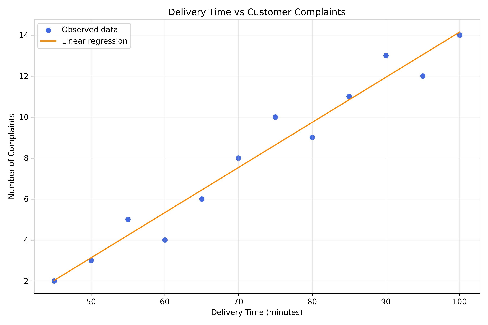

# Delivery Time and Customer Complaints Analysis

## Project Overview

This project investigates the relationship between delivery times and customer complaints using Python and statistical analysis.

The objective is to explore whether longer delivery times are associated with higher complaint levels and to demonstrate how data analysis can support operational decision-making in a delivery business.

## Business Questions

* Is there a relationship between delivery time and customer complaints?
* How strong and in what direction is the observed relationship?
* Can linear regression help describe the relationship between the two variables?
* What are the limitations of using a small dataset to inform business decisions?

## Tools and Technologies

* **Python** — data analysis and statistical computing
* **Pandas** — data manipulation
* **SciPy** — correlation and linear regression
* **Matplotlib** — data visualisation
* **Git and GitHub** — version control and project sharing

## Dataset

The dataset contains the following variables:

| Variable        | Description                   |
| --------------- | ----------------------------- |
| `Day`           | Observation day               |
| `Delivery_Time` | Delivery time in minutes      |
| `Complaints`    | Number of recorded complaints |

The current dataset contains 12 illustrative observations. It is intended to demonstrate analytical techniques and should not be interpreted as representative of a real delivery business.

## Methodology

1. Load and inspect the dataset using pandas.
2. Explore the relationship between delivery times and complaints.
3. Calculate the Pearson correlation coefficient.
4. Perform simple linear regression using SciPy.
5. Generate a scatter plot with a fitted regression line.
6. Explore a model-based estimate at a delivery time of 82 minutes.
7. Interpret the findings while considering the limitations of the data.

## Visualisation

The project includes a scatter plot and regression line to help illustrate the relationship between delivery time and complaints.



## Key Considerations

* Correlation does not establish causation.
* A small dataset limits the reliability and generalisability of conclusions.
* Factors such as traffic, weather, order volume and peak-hour demand may influence both delivery performance and customer complaints.
* Predictions from a simple linear regression model should be interpreted cautiously, particularly outside the observed data range.

## Project Structure

```text
delivery-time-complaints-analysis/
├── analysis.py
├── delivery_data.csv
├── correlation_analysis.png
├── Requirements.txt
├── README.md
└── .gitignore
```

## Installation and Usage

### 1. Clone the repository

```bash
git clone https://github.com/allthingsdatawithMole/delivery-time-complaints-analysis.git
cd delivery-time-complaints-analysis


### 2. Install the dependencies

```bash
py -m pip install -r Requirements.txt
```

### 3. Run the analysis

```bash
py analysis.py
```

## Future Improvements

* Analyse a larger, real-world delivery dataset.
* Include additional explanatory variables such as distance, weather and order volume.
* Evaluate regression assumptions and model performance.
* Compare alternative statistical or machine learning models.
* Develop an interactive dashboard for monitoring delivery performance.

## Author

Developed as a Python data analysis portfolio project to demonstrate statistical analysis, data visualisation and analytical problem-solving.
